<p align="center">
  
</p>

<p align="center">
  
  
  
  
</p>

<p align="center">
  <a href="https://mohitgora950.github.io"><b>🌐 Live portfolio</b></a> ·
  <a href="https://mohitgora950.github.io/dragon.html"><b>🐉 Play the dragon game</b></a> ·
  <a href="https://github.com/mohitgora950"><b>👤 GitHub profile</b></a>
</p>

> **TL;DR:** My personal portfolio with a Three.js 3D hero, plus **Dragon Flight**, an arcade canvas game where you burn
> tower banners to unlock my repositories and fight a boss. Everything is hand-written HTML, CSS and JavaScript with no build step.

## ✨ What's inside

**Portfolio (`index.html`)**
- 🔥 Three.js hero: a neural-network core inside armillary rings, with ember and snow particles and mouse parallax
- 🧭 Story-style chapters: about, experience timeline, skills, AI lab, projects, hobbies and contact
- 🌐 Interactive 3D skills sphere you can drag, and a clickable RAG pipeline explainer
- 📱 Fully responsive, respects `prefers-reduced-motion`, works without WebGL

**Dragon Flight (`dragon.html`)**
- 🐉 Procedural dragon: chained spine, flapping tattered wings, lava-crack glow and fire particles
- ⚔️ Enemies that fight back (archers, ice wraiths, diving ravens) and a **Frost Wyrm** boss
- 📈 Health and fuel, dash, combos up to x10, ranks, power-ups and best-score tracking
- 🔊 Procedural sound effects with the Web Audio API, no audio files

## 🚀 Run locally

```bash
git clone https://github.com/mohitgora950/mohitgora950.github.io.git
cd mohitgora950.github.io
python -m http.server 5500
# open http://localhost:5500
```

## 📁 Structure

```
├── index.html            # portfolio page
├── style.css             # theme tokens + layout
├── main.js               # Three.js hero, skills sphere, interactions
├── dragon.html           # Dragon Flight game shell + HUD
├── dragon.js             # game engine (canvas 2D + Web Audio)
└── assets/
    ├── Mohit_Gora_Resume.pdf
    ├── profile-hero.svg  # animated 3D banner for the GitHub profile
    ├── dragon-banner.svg
    └── github/           # repo banners and profile project cards
```

## ✏️ Customising

- Text, projects and links: `index.html`
- Colours and fonts: the `:root` variables at the top of `style.css`
- Hero roles and skills-sphere words: the `roles` and `words` arrays in `main.js`
- Game repos (one tower per repo): the `REPOS` array at the top of `dragon.js`

Feel free to fork it for your own portfolio. A ⭐ is appreciated if it helps.

---

<p align="center">Made by <a href="https://github.com/mohitgora950"><b>Mohit Gora</b></a> · <a href="mailto:mohitgora950@gmail.com">mohitgora950@gmail.com</a></p>
